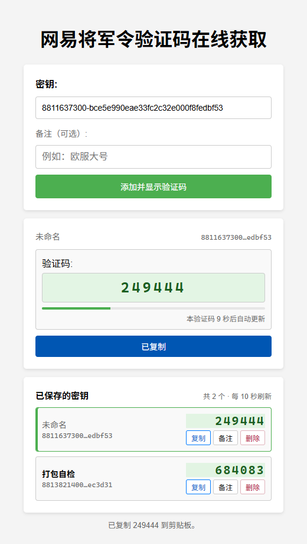

# 网易将军令验证码生成器（本地离线版）

把密钥（形如 `8810552096-5faf56ca673d910187068f1373e679c0`）粘贴进来，本地算出 6 位动态验证码，并跟着 30 秒窗口自动更新。支持保存多个密钥、给每个密钥写备注、打开应用就把所有密钥的当前验证码一起显示出来。

- **纯本地计算**：不联网、不上传密钥，算法与 `battla.net/163code.php` 的输出逐位一致。
- **免安装**：下载一个 exe 双击即用，不需要 Node.js、不需要运行库。
- **可复现**：整套源码、算法、AES 实现和测试都在这个仓库里，`npm test` 就能自己验一遍。



## 下载使用

到 [Releases](../../releases/latest) 下载 `163Code-1.0.0.exe`，双击运行即可。对着截图里的界面：

1. 粘贴密钥，可选填一行备注（例如“国服主号”），点“添加并显示验证码”或直接回车。
2. 上面的大卡片显示当前密钥的验证码、倒计时进度条和“复制验证码”按钮。
3. 下面的“已保存的密钥”列表把**每个**密钥当前的验证码都列出来，每 10 秒整体刷新一次；点某一行切换到大卡片，行内可以复制、改名、删除。

首次运行 Windows 可能提示“Windows 已保护你的电脑”，因为 exe 没有购买代码签名证书：点“更多信息 → 仍要运行”。程序只在本地计算，不发任何网络请求。

> 要求：Windows 10/11 64 位。exe 是 electron-builder 的 `portable` 目标，运行时会把自身解压到临时目录，退出后自动清理，不会写注册表。

## 功能

- **30 秒窗口自动刷新**：每秒钟按当前时间重算，只在变化时更新画面，所以睡眠唤醒、系统时间跳变后 1 秒内自动对齐；进度条与“本验证码 N 秒后自动更新”同步。
- **密钥收藏 + 备注**：最多 20 个，存在本机（网页版 `localStorage`，桌面版在 `%APPDATA%\网易将军令验证码生成器`），重启后自动载入并显示。
- **多密钥看板**：一眼看全所有账号的验证码，每 10 秒刷新；点行切换、行内改名、行内删除（删掉正在显示的那个会自动切到下一个）。
- **输入容错**：自动修掉从微信/Excel/记事本复制来的全角数字、全角减号、`—`/`–`/`−` 各种破折号、零宽字符、首尾空格与换行；大小写等价。
- **诚实的复制反馈**：剪贴板被拒绝时明确提示“复制失败”，不会显示“已复制”把人坑在旧码上。
- **窗口自适应**：窗口按内容高度自适应并夹在工作区内，窄到大屏都不会溢出；390px 宽度不出现横向滚动条；全键盘可操作，验证码更新会通过读屏状态区播报。

## 算法

与原站一致（细节见 `src/codegen.js`、`src/aes.js`）：

1. 密钥 = 10 位数字序列号 + `-` + 32 位十六进制字符；
2. 取当前时间（并加上与原站校准的约 2.7 秒偏移，本机时钟往往比参考服务慢），换成东八区时间；
3. 用“年、月、日、时、分、30 秒槽位 + 6 字节序列号”拼出一个 16 字节明文块；
4. 用密钥的 32 个字符每两个拼成一个字节，作为 AES-128 密钥，对明文做一次 AES 加密；
5. 取密文第 11–16 字节，各自对 10 取模，拼成 6 位验证码。

`src/aes.js` 是项目内自带的 AES-128 单块实现，不依赖 WebCrypto/Node crypto，因此网页和 Electron 里都能跑；`test/aes.test.mjs` 用 `node:crypto` 的 24 组随机向量和若干固定向量逐位校验。

## 开发

需要 Node.js ≥ 20；浏览器测试需要一个已安装的 Chrome。

```bash
npm install                 # 只安装测试依赖（playwright）
npm run build               # src/ → dist/ 静态站点
npm test                    # 算法测试：AES 向量 + 密钥规整 + 30 秒窗口
npm run test:browser        # 构建后跑页面行为测试（假时钟翻窗、收藏、备注、复制失败、窄屏）
npm run test:live           # 与本仓库无关：和线上参考站点逐项比对两个密钥（需要联网）
npm run desktop:install     # 安装 Electron 打包依赖
npm run desktop:build       # 生成 release/163Code-1.0.0.exe
```

`npm run test:portable` 会启动打包好的 exe，用 CDP 断言窗口尺寸、收藏列表与出码，并把窗口截图写到 `checks/portable-window.png`。想验证别处的 exe（比如从 Releases 下载的那份）：

```bash
CODE163_EXE="C:\Users\you\Downloads\163Code-1.0.0.exe" npm run test:portable
```

### 目录

```
src/          页面与算法（index.html、styles.css、app.js、codegen.js、aes.js）
test/         算法、页面（Playwright + 假时钟）、打包产物测试
desktop/      Electron 外壳：main.cjs（app:// 协议 + 内容自适应）、preload.cjs
build.mjs     把 src/ 复制到 dist/
docs/         截图
```

### 打包时的几个坑

- 如果所在网络有 TLS 拦截代理（例如装了 SteamTools 一类工具），Node 自带的根证书不认它，打包会报 `unable to verify the first certificate`：加 `NODE_OPTIONS=--use-system-ca` 让 Node 信任 Windows 证书存储。
- electron-builder 默认每次重新下载约 150MB 的 Electron，下载容易卡在 0 字节：加 `--config.electronDist=node_modules/electron/dist` 直接复用已解压的 Electron。
- 重复打包时报 `EBUSY: resource busy or locked, unlink '...\release\win-unpacked\resources\app.asar'`，通常是有杀毒/索引进程短暂占着旧产物：换个输出目录再覆盖即可，`--config.directories.output=../release-out`。
- 在 Electron 写的工具里启动打包好的 exe 时，务必确认环境里没有 `ELECTRON_RUN_AS_NODE=1`，否则 exe 会退化成纯 Node 进程，“双击后没有任何窗口”。

```powershell
$env:NODE_OPTIONS='--use-system-ca'
npm --prefix desktop run dist:local
```

## 说明

- 本项目是**独立重写**：页面结构参照原站，算法通过观察原站对给定密钥的输出复现，代码全部由本项目编写。与原站（以及网易、暴雪）没有任何关联，也未获其授权或认可。
- 原站页面上的“⬇⬇⬇⬇⬇战网登录教程…”副标题与教程大图按作者要求移除，`src/Pictures/gf.jpg` 仍保留在仓库里，需要恢复原样时把那两行加回 `src/index.html` 即可。
- 密钥与备注以明文保存在本机，不会上传；请自行保管好设备。
- 请在符合当地法律与服务条款的前提下使用；因使用本工具造成的账号风险由使用者自行承担。

## 许可

[MIT](LICENSE)